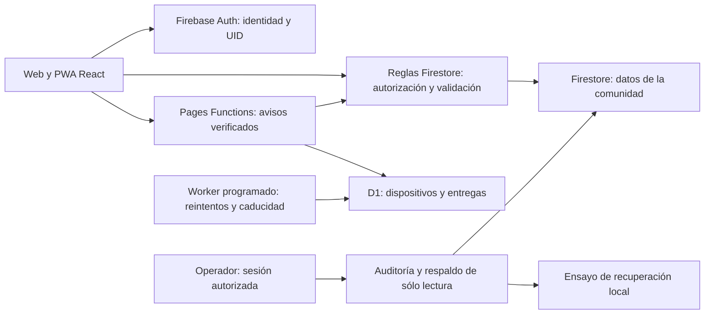

# Backend de LaCantera: contrato y evolución

Revisado el 13 de noviembre de 2026. Describe el sistema real y separa las mejoras previstas de lo implementado.

## Límites y fuentes de verdad



- Identidad: UID de Firebase Auth. El nombre público y el correo de contacto no son claves de autorización. Los proveedores vinculados comparten UID; su correo puede diferir del principal. Los roles administrativos proceden de claims, nunca de un campo editable de perfil.
- Datos de negocio: proyecto `gen-lang-client-0853130215`, base nombrada `ai-studio-647af55f-499b-43f3-9268-9bf5f62701bb`, región `eur3`. Otra base existente del proyecto queda fuera de LaCantera y de las escrituras de esta revisión.
- Avisos: D1 `lacantera-push`, ID `01055525-2120-4e22-aa12-5d6bf5a0e98e`. No es una segunda copia de los mensajes. Conserva suscripciones, preferencias, entregas mínimas y límites de frecuencia.
- Las colecciones Firestore aparecen con el primer documento válido: no necesitan documentos ficticios ni tablas vacías. Las reglas, índices y pruebas definen qué se puede crear. D1 sí usa migraciones SQL explícitas.
- Las claves VAPID privadas y credenciales del operador no se compilan en la web. La configuración pública Firebase no sustituye las reglas.

## Inventario de datos

El inventario exacto y versionado del formato de respaldo se encuentra en `scripts/community-backup.cjs`: 27 colecciones raíz y tres subcolecciones admitidas. Una colección comunitaria nueva debe actualizar contrato, permisos, índices, exportación, supresión y pruebas antes de usarse.

| Área | Colecciones | Visibilidad y relación principal |
| --- | --- | --- |
| Perfiles | `communityProfiles`, `communityPublicProfiles` | Privado por UID; proyección pública separada sin consentimiento, edad o correo. Se crean/actualizan atómicamente. |
| Participación | `communityEvents`, `communityFixtures` | Evento por ID; cruces por `eventId`. Aforo máximo 64, torneos hasta 32; respetar los límites actuales del producto. |
| Historial y avisos | `communityEventChanges`, `communityEventPromotions`, `communityEventDeliveries`, `communityEventNotices` | Historial inmutable y entrega por destinatario; no convertir bandejas privadas en un directorio público. |
| Comunidad | `communityPosts`, `communityLikes`, `communityComments`, `communityFollows` | Autor/post/destinatario por UID/ID; pares deterministas evitan duplicados. Las interacciones de publicaciones eliminadas necesitan limpieza posterior. |
| Invitaciones | `communityInvitations`, `communityEventAdmissions/{eventId}/members/{uid}` | Código aleatorio, caducidad y consumo único; admisión privada y plaza se escriben juntas. Una amistad no autoriza un evento privado. |
| Contactos | `communityConnections/{uid}/members/{peerId}` | Dos aristas recíprocas en una operación atómica; bloqueo y desconexión retiran ambas. Los padres pueden ser virtuales. |
| Mensajes | `communityConversations/{pair}/messages/{id}`, `communityMessageReads` | Par de UIDs canónico, autor inmutable, paginación acotada y marcadores privados. Los archivos de bajas son otro estado del esquema, no chats activos. |
| Equipos | `communityTeams`, `communityTeamMembers`, `communityTeamInvites`, `communityTeamJoinRequests` | Propietario único y membresía coherente; aprobación y transferencia atómicas. |
| Gobierno | `communityConfiguration`, `communityAccountModeration`, `communityBlocks`, `communityVerifications`, `communityReports`, `communityRightsRequests` | Configuración administrativa, privacidad por propietario, moderación y solicitudes según reglas específicas. |

No agregar datos de cuenta a las proyecciones públicas para simplificar consultas. Un campo nuevo requiere revisar también `normalization`, derechos, respaldo y consumidores; no basta con TypeScript en el navegador.

## Comprobación repetible

```sh
pnpm audit:backend --cloud
pnpm audit:backend --input output/private/respaldo.json
pnpm --dir push-worker --ignore-workspace exec wrangler d1 execute lacantera-push --remote --file audit/health.sql --json
```

El primer comando lee producción, a un instante consistente, y conserva el snapshot sólo en memoria. Devuelve cantidades y códigos, nunca datos de usuarios. No repara ni migra registros. El segundo sólo admite un respaldo privado con manifiesto válido. El tercero consulta esquema, referencias y cantidades de D1; no devuelve datos de suscripciones. Fallar la autenticación de un endpoint no autoriza ampliar permisos automáticamente.

El auditor comprueba invariantes seleccionadas, reglas desplegadas, índices listos y protección de borrado. No es un validador exhaustivo de todos los campos, una auditoría de IAM ni una garantía de disponibilidad. Las pruebas de reglas siguen siendo necesarias para escrituras adversarias y concurrencia. Los SDK de servidor omiten las reglas: sus credenciales e IAM requieren un control independiente.

## Ruta de migración

1. **Preparar:** conservar commit, reglas, índices, diccionario, política de bajas y un respaldo cifrado reciente. Separar formato de exportación de versión de aplicación. Congelar nuevas escrituras durante el corte final o implementar un registro de cambios durable antes de plantear una migración en vivo.
2. **Exportar:** los documentos actuales se conservan como valores REST tipados, con paths y manifiesto SHA-256. No convertir Int64 a `Number`, timestamps a milisegundos, bytes a texto ni referencias a nombres visibles. Exportar por separado Auth, D1 y futuros archivos multimedia: el respaldo de comunidad no los incluye.
3. **Adaptar por dominio:** introducir interfaces de repositorio para perfiles, feed, eventos, equipos y mensajes. Hoy los contextos React aún llaman directamente a Firestore; migrar un dominio por vez manteniendo los componentes y las pruebas de comportamiento.
4. **Importar en un destino aislado:** conservar los identificadores de negocio. En PostgreSQL, por ejemplo, convertir plantillas, esperas y miembros a tablas con claves compuestas/foráneas, no a listas de nombres. Mantener `identity_provider + provider_subject` separado del ID interno; nunca reconciliar cuentas sólo por nombre o correo.
5. **Verificar:** cantidades, contenido tipado, proyecciones, propietarios, pares, aforo, caducidad y bajas. Reproducir en el servidor nuevo las autorizaciones que hoy están en Firestore. Una importación de filas sin permisos equivalentes no es una migración terminada.
6. **Cortar y recuperar:** ensayar primero, definir ventana, criterios de abortar y único escritor. Evitar dual-write sin idempotencia y resolución de conflictos. Mantener el origen recuperable, sin restaurar datos ya eliminados por sus titulares.

No hay todavía un importador PostgreSQL, adaptación de Auth completa, CDC ni cambio de proveedor sin interrupción. El ensayo de noviembre verifica restauración de documentos actuales en un emulador, no esos componentes futuros.

## Recuperación y operación pendientes

Protección de borrado de la base activada. No impide borrar documentos individuales, no reemplaza copias ni protege contra una credencial administrativa comprometida. PITR de Firestore permanece desactivado; no se ha habilitado facturación. Las copias locales existentes requieren custodia y cifrado por el operador; no hay una tarea diaria automática ni una copia externa verificada.

Antes de una campaña amplia: establecer copias cifradas frecuentes con aviso de fallo, retención y custodia de claves; ensayar Auth y archivos por separado; fijar objetivos de recuperación medibles; revisar acceso mínimo/MFA de operadores y cuotas/abuso. No se presenta un RPO/RTO garantizado sin esa operación. Para D1 Free, la documentación describe siete días de Time Travel; en esta sesión la consulta de su información fue rechazada por autorización, por lo que no se acredita un ensayo de recuperación de D1.

Referencias: [operaciones atómicas y límites](https://firebase.google.com/docs/firestore/manage-data/transactions), [reglas y SDK de servidor](https://firebase.google.com/docs/firestore/security/rules-conditions), [identidades vinculadas](https://firebase.google.com/docs/auth/web/account-linking), [protección de base](https://firebase.google.com/docs/firestore/manage-databases), [migraciones D1](https://developers.cloudflare.com/d1/reference/migrations/), [Time Travel](https://developers.cloudflare.com/d1/reference/time-travel/). Procedimientos existentes: [BACKUP_RECOVERY.md](BACKUP_RECOVERY.md) y [ACCOUNT_RIGHTS.md](ACCOUNT_RIGHTS.md).
